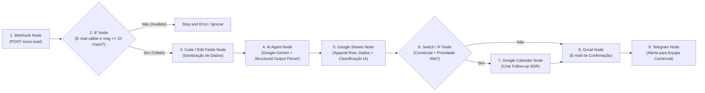

# 🎯 Desafio Criativo DIO: Planejando Automações com n8n Usando Apenas Bons Prompts

> **Bootcamp / Trilha:** Santander 2026 - Automação com n8n  
> **Autor:** [Bruno Cavasana](https://github.com/bhcavasana)  
> **Arquivo do Prompt Final:** [`prompt-final-n8n.md`](./prompt-final-n8n.md)

---

## 📌 Visão Geral do Projeto

Este repositório documenta a construção progressiva de um **Prompt Estruturado para Engenharia de Workflows no n8n**, desenvolvido como parte do Desafio Criativo da DIO. O objetivo é transformar uma necessidade real de negócio (triagem inteligente de chamados e leads com IA) em uma especificação clara de automação contendo **intenção, contexto, ferramentas, etapas sequenciais, regras de negócio e guardrails**.

---

## 🧱 Passo 1: Definição da Automação Desejada

```text
Quero criar uma automação no N8N para triagem inteligente, classificação com IA e agendamento automático de leads e solicitações comerciais recebidas via formulário web e WhatsApp/Webhook.

Público ou responsável:
Equipe comercial (SDRs e Executivos de Contas) e time de Atendimento ao Cliente.

Resultado esperado:
Classificar automaticamente a urgência e o perfil do lead usando o Google Gemini, registrar os dados validados no Google Sheets, criar um evento ou lembrete de follow-up no Google Calendar e enviar uma notificação estruturada para a equipe comercial no Slack/Telegram, além de um e-mail personalizado de confirmação ao cliente via Gmail.
```

---

## 🧱 Passo 2: Contexto, Ferramentas, Fluxo e Regras

```text
Ferramentas envolvidas:
Webhook (Formulário Web), Google Gemini (AI Agent / LLM), Google Sheets, Google Calendar, Gmail e Telegram (ou Slack).

Fluxo desejado:
1. Receber os dados do novo lead em tempo real através de um Webhook HTTP POST (nome, e-mail, telefone, empresa e mensagem).
2. Validar e higienizar os campos recebidos (verificar se o e-mail possui formato válido e se a mensagem não está vazia).
3. Analisar a mensagem do lead com o modelo Google Gemini para classificar a intenção (Comercial, Suporte ou Parceria), o nível de prioridade (Alta, Média ou Baixa) e gerar um resumo executivo de 2 linhas.
4. Registrar os dados originais junto com a classificação da IA em uma planilha de controle no Google Sheets.
5. Se a intenção for Comercial e a prioridade for Alta, criar uma tarefa/bloco de follow-up na agenda comercial no Google Calendar.
6. Enviar um alerta imediato no Telegram para o time responsável com o resumo gerado pela IA e enviar um e-mail de confirmação personalizado ao lead via Gmail.

Regras importantes:
- Ignorar registros sem endereço de e-mail válido ou mensagens com menos de 10 caracteres (spam/teste).
- Garantir saída estruturada (JSON válido) na resposta do agente de IA antes de gravar na planilha (padrão Generate -> Validate -> Act).
- Nunca expor chaves de API no fluxo (utilizar exclusivamente o Credential Manager do n8n).
- Caso o envio de e-mail ou a API do LLM falhe, acionar tentativa automática (Retry) e registrar o erro em uma aba de logs sem interromper o restante do workflow.
```

---

## 🧱 Passo 3: Prompt Final Consolidado

```text
Atue como um especialista em N8N.

Crie uma automação para triagem inteligente, classificação com IA e encaminhamento automático de leads recebidos via formulário web.

Público:
Equipe comercial (SDRs e Executivos de Contas) e time de Atendimento ao Cliente.

Ferramentas envolvidas:
Webhook, Google Gemini (AI Agent), Google Sheets, Google Calendar, Gmail e Telegram.

Fluxo:
1. Receber os dados do lead em tempo real via Webhook (nome, e-mail, empresa, telefone e mensagem).
2. Validar os campos obrigatórios e o formato do e-mail recebido.
3. Utilizar o Google Gemini para classificar a intenção do contato (Comercial, Suporte ou Parceria), definir a prioridade (Alta, Média ou Baixa) e redigir um resumo executivo da solicitação.
4. Salvar os dados do lead e os metadados gerados pela IA em uma planilha no Google Sheets.
5. Criar automaticamente um lembrete de follow-up no Google Calendar para leads comerciais de alta prioridade.
6. Enviar um e-mail de confirmação contextualizado ao lead via Gmail e notificar a equipe responsável no Telegram com o resumo da oportunidade.

Regras:
- Ignorar registros sem e-mail válido ou mensagens com menos de 10 caracteres.
- Utilizar Structured Output Parser para garantir que a resposta da IA retorne estritamente em JSON padronizado.
- Configurar tratamento de falhas (Error Trigger / Retry on Fail) para evitar perda de leads em caso de instabilidade de rede.

Explique quais nós do N8N devem ser utilizados e a lógica de funcionamento do workflow.
```

---

## 🤖 Resultado Gerado pelo Prompt: Arquitetura do Workflow no n8n

Abaixo está o desenho técnico da automação resultante da aplicação do **Prompt Final**:



### Nós do n8n Utilizados e Lógica de Funcionamento

| Ordem | Nó do n8n | Função na Arquitetura |
| :-: | :--- | :--- |
| **1** | **Webhook** | Ponto de entrada (`Trigger`) que escuta requisições `POST` enviadas pelo formulário de captação. |
| **2** | **IF** | Aplica a regra de negócio inicial: valida via Regex se o campo `email` é válido e se `mensagem.length >= 10`. |
| **3** | **Edit Fields (Set) / Code** | Padroniza strings (remove espaços extras, normaliza letras minúsculas no e-mail e adiciona `timestamp`). |
| **4** | **AI Agent + Google Gemini Chat Model + Structured Output Parser** | Analisa o texto do lead e retorna um JSON estrito com `{ "categoria": "...", "prioridade": "...", "resumo": "...", "resposta_sugerida": "..." }`. |
| **5** | **Google Sheets (`Append Row`)** | Registra de forma persistente os dados do lead e a análise da IA para auditoria e métricas comerciais. |
| **6** | **IF / Switch** | Avalia se `categoria == "Comercial"` e `prioridade == "Alta"` para decidir sobre o agendamento imediato. |
| **7** | **Google Calendar (`Create Event`)** | Agenda automaticamente um bloco de 15 minutos para o SDR entrar em contato com o lead quente. |
| **8** | **Gmail (`Send a Message`)** | Envia um e-mail de confirmação personalizado confirmando o recebimento da solicitação. |
| **9** | **Telegram (`Send a Text Message`)** | Notifica o canal da equipe comercial em tempo real com os dados do lead, prioridade e resumo executivo. |
| **10** | **Error Trigger (Global)** | Captura qualquer exceção de API em produção e alerta o administrador do sistema. |
